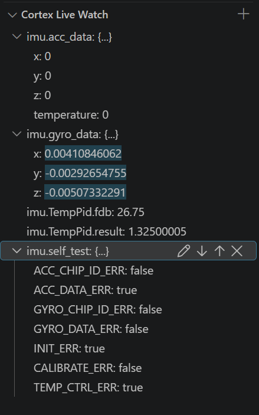
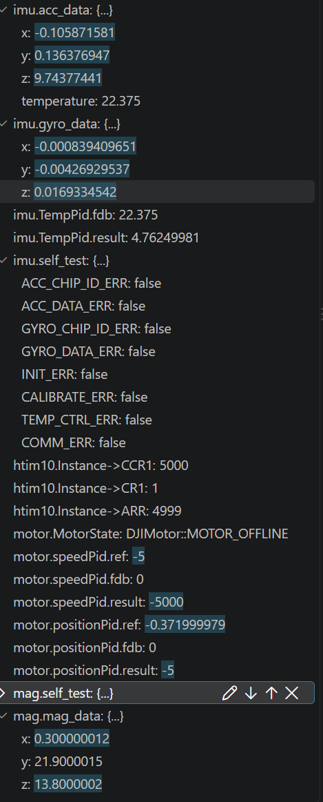
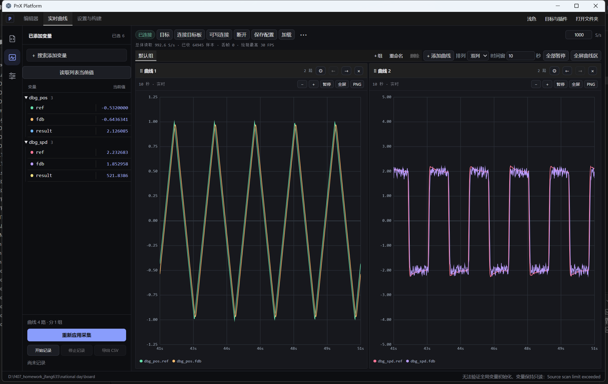

bsp，libs,BMI088,M2006,threads

- alive灯效
  上电三个灯全灭约 5 秒（IMU 配置+标定）

​	alive正常=蓝灯闪

​	初始化失败=红灯慢闪；线程挂=红灯常亮；正常=绿灯


- 芯片 ID、温度、配置寄存器都正常，但 `acc_data.x/y/z` 一直是 0：软复位后第一次ACC_PWR_CTRL(0x7D)=0x04 不生效，加速度计没有通电，一直读回 `0x00`

​	解决方法有两种，(1) 复位后先读一两次芯片 ID（官方做法，还能顺便校验通信）；(2) 把关	键寄存器写两次（本次做法）



​	temperature=0:没有赋值

​	mag




- control

  PID 参数从 `M2006` 构造函数挪到 control 线程

  加了 `PIDTuning` 结构体,循环里 `ApplyTo()`：

  参考曲线 RefCurve：三角波 `-1 ~ +1`、

​	PnX 的变量目录只收录全局变量 + 简单类型 + 有确定 RAM 地址，motor.*看不到 ,加了镜像结构体：

```
struct DebugData { float ref; float fdb; float result; };
DebugData dbg_spd{};
DebugData dbg_pos{};
```

循环里把两个环的 ref/fdb/result 拷进去

dbg_spd.ref   = motor.speedPid.ref;

​    dbg_spd.fdb   = motor.speedPid.fdb;

​    dbg_spd.result = motor.speedPid.result;

​    dbg_pos.ref   = motor.positionPid.ref;

​    dbg_pos.fdb   = motor.positionPid.fdb;

​    dbg_pos.result = motor.positionPid.result;


