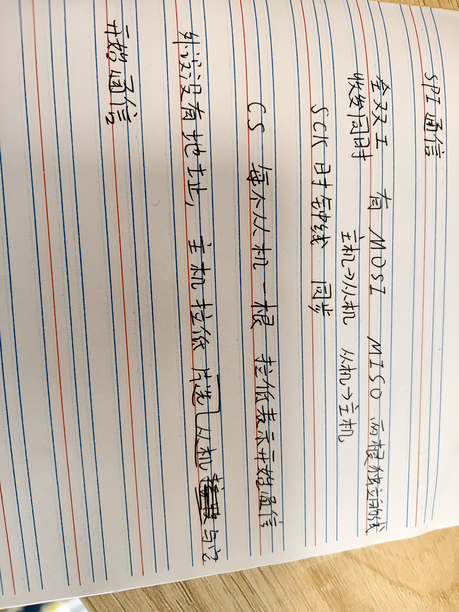

bmi088

| STM32 引脚 | 接到哪   | 作用 |
| ---------- | -------- | ---- |
| PB3        | BMI088   | SCK  |
| PA7        | BMI088   | MOSI |
| PB4        | BMI088   | MISO |
| PA4        | 加速度计 | 片选 |
| PB0        | 陀螺仪   | 片选 |

NSS=software

模式3 CPOL=High CPHA=2Edge

84MHz÷ 256 = 328kHz，BMI088 最多支持 10MHz

1.拉低片选 2.寄存器地址 （读addr | 0x80，写addr & 0x7F）3.收发数据  4.拉高片选

写寄存器

检验ID ACC_CHIP_ID_ADDR(0x00) 加速度计0x1E,陀螺仪0x0F

陀螺仪零偏标定

加速度计要多丢一个字节，（在readreg中丢了，之后ReadAccData中不用再丢）

raw * IMU_ACCEL_6G_SEN;

raw_z * IMU_GYRO_2000_SEN - Gyro_offset
